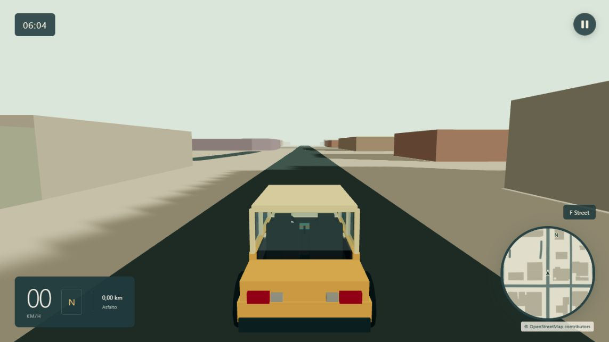

# Free Road

Jogo de direção livre em Three.js e TypeScript: explore ruas do OpenStreetMap, entre na cabine e acompanhe o ciclo de dia e noite. Interface em português, sem conta e sem backend de jogo.

## Jogar

[**Jogar no navegador**](https://malgany.github.io/Free-Road/) · [Repositório](https://github.com/malgany/Free-Road)

Abra **Jogar.html** no Chrome, Edge ou Brave, ou use a publicação no GitHub Pages. O mapa de exemplo de Davis e a pista de teste funcionam offline. **Jogar na minha região** pede permissão de localização e consulta o OpenStreetMap; também é possível informar coordenadas em **Pausa → Configurações → Mapa**.

Se a localização não funcionar ao abrir o arquivo diretamente, use coordenadas ou o servidor local. O navegador precisa de WebGL 2. Novas regiões exigem internet ou um recorte válido no cache.

## Controles

| Atalho | Ação |
| --- | --- |
| W / ↑ | Acelerar |
| S / ↓ | Frear, depois dar ré; acender luzes brancas |
| A D / ← → | Esterçar |
| Espaço | Frear sem engatar ré |
| C | Aérea → terceira pessoa → cabine → ortográfica |
| Scroll | Aproximar / afastar, com retenção na terceira pessoa e na transição ortográfica |
| Mouse na cabine | Olhar pelas janelas |
| Clique na cabine | Capturar cursor quando o navegador permitir |
| X / duplo clique | Centralizar o olhar |
| Esc | Pausar; nas configurações, retornar ao menu |
| R | Voltar ao ponto de partida do recorte ativo |
| F3 | Diagnóstico |

O jogo começa na vista aérea, no afastamento máximo. A terceira pessoa fica aproximadamente 5 m atrás do carro. Continue afastando na aérea para passar à ortográfica: ela tem enquadramento fixo e não amplia. Ao aproximar nela, a retenção do scroll precede a volta à aérea. C troca diretamente entre as quatro visões.

Na pausa, **Configurações** fica entre **Continuar** e **Voltar ao início**. As abas são Mapa, Direção, Câmera, Visual e Atalhos. Sensibilidade começa em 100% e altura aérea em 105 m a cada abertura; **Restaurar padrões** restaura direção, câmera e gráficos sem alterar o mapa. Há botões de direção em telas de toque e seleção de câmera no menu.

## Mundo e iluminação

- Velocidade máxima de 199 km/h; ré limitada a 32,4 km/h. Física arcade a 60 Hz, colisões e interpolação entre quadros.
- Ruas, construções e terrenos acompanham as informações OSM disponíveis. Floresta, mata e vegetação arbustiva usam verde escuro. Nos recortes com menos de três edifícios OSM, ruas urbanas podem receber até 48 casas ilustrativas. Elas são identificadas como sintéticas nos dados e não representam imóveis reais; não ocupam áreas mapeadas de água, vegetação ou vias.
- O nome da rua aparece discretamente sobre o minimapa. Quando há nomes de bairro/região nos dados, a entrada é anunciada no topo. Ausência de dados não é substituída por um bairro inventado.
- Relógio: dia das 06:00 às 18:00 (10 min reais), entardecer até 20:00 (90 s), noite até 04:00 (5 min), amanhecer até 06:00 (90 s). Pausa congela o ciclo. Faróis acendem automaticamente.
- Marcas de pneus na grama, mata, terra e chão neutro; no asfalto, ao frear ou fazer curvas fechadas. Limite de 2.048 segmentos e 48 partículas de poeira.
- Interior geométrico com volante móvel, painel, bancos e janelas. Espelhos são decorativos. Sem trânsito, pedestres, missões ou multiplayer.

## Streaming e privacidade

O GPS é lido somente na ação inicial solicitada. A posição do carro virtual antecipa novas áreas; a API do OpenStreetMap recebe os limites geográficos consultados. Os recortes começam em 700 m e podem diminuir para 450/250 m em regiões densas. As consultas usam centros quantizados a 0,001 grau.

O cache IndexedDB guarda até 64 mapas derivados, com validade de 30 dias; há até oito em memória. Inclui a origem geográfica. **Configurações → Mapa → Limpar mapas salvos** limpa o cache. Ele pertence ao navegador/origem: arquivo local, outra porta de localhost e GitHub Pages podem ter caches separados. Se o armazenamento persistente for negado, o cache funciona apenas na sessão.

A busca e a preparação geográfica rodam em Web Worker. A criação das malhas é dividida em pequenos lotes; a janela anterior continua ativa até a nova ficar pronta. Antes da troca, a posição do carro precisa estar livre. A janela antiga libera suas malhas e materiais; setores distantes da janela atual deixam de ser desenhados. O mapa inteiro do mundo nunca é acumulado na GPU.

A rede ainda pode atrasar: se não houver dados, a borda atual permanece sólida e uma nova tentativa ocorre em 30 s. O terreno é plano; túneis e cruzamentos de vias em altitudes sobrepostas são omitidos nos recortes dinâmicos. Não use o jogo como navegação real.

## Desenvolvimento

Requer Node.js 22+.

~~~sh
npm ci
npm start
npm test
npm run build
~~~

O servidor usa 127.0.0.1. O build produz dist/ e Jogar.html, incluindo o Worker embutido. A base relativa suporta subdiretórios do GitHub Pages. A advertência de pacote acima de 500 kB é esperada para o HTML portátil com Three.js.

A workflow .github/workflows/pages.yml testa, compila e publica dist/ ao receber commits em main. Configure **Settings → Pages → Source → GitHub Actions** no repositório. Não há chaves de API nem segredos necessários.

### Organização

- src/main.ts: coordenação, HUD, pausa e minimapa a 30 Hz.
- src/settings-ui.ts, camera.ts, daylight.ts: configurações, câmeras e relógio.
- src/map.worker.ts, map-client.ts, location.ts: busca/preparação fora da animação.
- src/map-cache.ts, streaming.ts: cache e alinhamento entre recortes.
- src/importer.ts, scenery.ts, spatial.ts, place-names.ts: OSM, casas ilustrativas, índice espacial e nomes.
- src/scene.ts: lotes de malhas, liberação de recursos, fachadas sólidas, iluminação e carro.
- src/vehicle.ts, collision.ts: física, sensibilidade, colisões e terrenos.
- tests/: testes determinísticos. docs/: evidências e registros históricos.

A amostra de Davis tem origem pública 38.5449, -121.7405. data/raw/ registra a fonte, data de coleta e dados brutos. npm run map:build regenera as amostras; npm run map:audit verifica a malha de ruas. A escala horizontal é 1,15: velocidade e distância do HUD são unidades de jogo, não medições geográficas de precisão.

## Licenças

Código: MIT, veja LICENSE. Dados OpenStreetMap brutos e derivados: [ODbL 1.0](https://opendatacommons.org/licenses/odbl/1-0/), com crédito a [OpenStreetMap contributors](https://www.openstreetmap.org/copyright). O crédito permanece no jogo. DATA-LICENSE.md e THIRD-PARTY-NOTICES.txt acompanham a distribuição. O carro, a interface e os elementos ilustrativos são próprios; nenhum recurso gráfico de outro jogo foi copiado.
